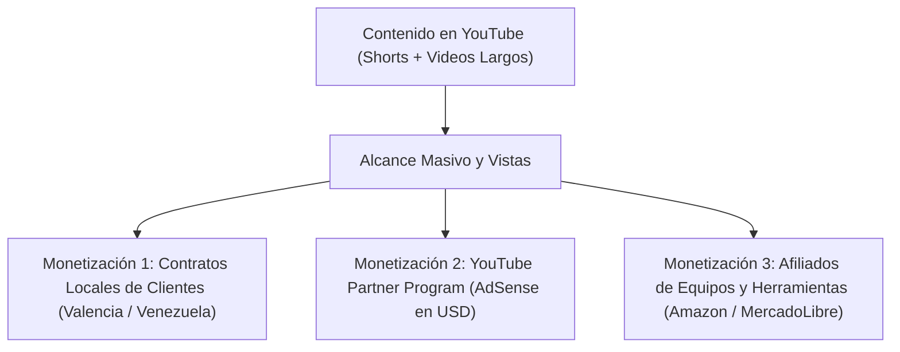

# 🚀 Esteban Palma: Guía de Despliegue Gratuito y Estrategia de Monetización en YouTube

---

## 🌐 1. Dónde y Cómo Subir la Página Web Gratis

Tu página web ya está completamente desarrollada, optimizada y probada tanto en versión de escritorio como en versión móvil dentro de tu carpeta:
`C:\Users\epalma\Documents\Esteban Palma`

Para publicarla en internet de forma **100% gratuita** con certificado de seguridad SSL (`https://`), te recomiendo las siguientes plataformas:

### Opción 1: Netlify Drop (La más fácil y rápida - En 30 segundos)
No necesitas saber de programación ni usar terminal:
1. Entra en [https://app.netlify.com/drop](https://app.netlify.com/drop).
2. Crea una cuenta gratuita (puedes iniciar sesión con Google o correo).
3. Abre tu explorador de archivos en Windows y ve a:
   `C:\Users\epalma\Documents\Esteban Palma`
4. **Arrastra la carpeta completa** hacia el círculo en la pantalla de Netlify que dice *"Drag and drop your site folder here"*.
5. ¡Listo! En segundos te dará un enlace público gratuito tipo `estebanpalma.netlify.app` con HTTPS activado.
6. En la pestaña **Site settings**, puedes cambiar el nombre por el que tú prefieras (ejemplo: `estebanpalma.netlify.app`).

### Opción 2: Vercel
1. Entra en [https://vercel.com](https://vercel.com) y crea tu cuenta gratuita.
2. Sube tu proyecto enlazándolo con un repositorio de GitHub o arrastrando el proyecto.
3. Es una de las plataformas más rápidas del mundo, con soporte mundial en CDN.

### Opción 3: GitHub Pages
1. Crea una cuenta en [https://github.com](https://github.com).
2. Crea un repositorio nuevo llamado `estebanpalma`.
3. Sube los archivos (`index.html`, `styles.css`, `app.js`, carpeta `assets` y carpeta `img`).
4. Ve a **Settings > Pages** y activa la rama `main`. Tu web quedará en `tuusuario.github.io/estebanpalma`.

---

## 🎥 2. Estrategia para Monetizar el Canal de YouTube `@cristaleriaestebanpalma`

Para monetizar en YouTube y simultáneamente conseguir clientes que contraten tus servicios de cristalería y cámaras, debes aplicar el **Embudo de Doble Ingreso**:

---

### A. Requisitos de Monetización de YouTube (Programa de Socios de YouTube - YPP)
Para que YouTube empiece a pagarte dinero por los anuncios en tus videos necesitas alcanzar **uno** de estos dos caminos:
1. **Ruta Videos Normales (Recomendada):**
   - 1,000 suscriptores.
   - 4,000 horas de visualización pública en los últimos 365 días.
2. **Ruta YouTube Shorts:**
   - 1,000 suscriptores.
   - 10 millones de visualizaciones de Shorts en los últimos 90 días.

---

### B. Cómo Crear Videos Atractivos usando las Fotos y Videos que ya Tienes

Tienes más de **360 fotos y videos reales** de obras terminadas. Con estas fotos puedes producir contenido de alto impacto siguiendo estos formatos:

#### 1. Formato "Antes y Después" (El rey de los Shorts)
- **Estructura (15 a 30 segundos):**
  - **Segundos 0-3 (El Gancho):** Muestra el espacio vacío, desordenado o en obra gris ("Mira cómo transformamos este techo común en una obra de arte moderna").
  - **Segundos 3-10:** Ráfaga rápida del proceso (estructura metálica, perfilería, colocación de láminas o paso de cables).
  - **Segundos 10-25:** El resultado final con iluminación cálida, música en tendencia y planos de detalle (los nichos LED, el cristal templado brillante o las 4 cámaras en vivo en el monitor).
  - **Llamado a la acción (CTA):** "Cotiza tu proyecto al WhatsApp en la descripción o en el primer comentario".

#### 2. Formato "El Error Costoso vs La Instalación Correcta" (Educativo y Viral)
- **Ejemplo para Cámaras:**
  - *"El error más común al instalar cámaras de seguridad: dejar cables expuestos al sol y al agua. Te mostramos cómo canalizamos con tubería y rack de seguridad 4U para que tu sistema dure 10 años."*
- **Ejemplo para Puertas de Baño / Vidrio:**
  - *"¿Por qué una puerta de baño de acrílico se daña rápido y una de vidrio templado de 8mm dura toda la vida? Mira esta diferencia."*

#### 3. Formato "Prueba Real de Visión Nocturna en Cámaras"
- Graba o muestra una captura de la oscuridad total en la noche vs cómo se ve en la pantalla del DVR con infrarrojo o luz cálida a color. A la gente le fascina ver la nitidez de las cámaras en tiempo real.

---

### C. Herramientas Gratuitas Recomendadas para Armar los Videos

1. **CapCut (Móvil y PC - 100% Recomendado):**
   - Importa 5 a 10 fotos de un mismo trabajo.
   - Usa la función **"Zoom y Recorrido"** o efectos de movimiento para que las fotos parezcan video.
   - Usa la herramienta de **"Texto a Voz" (Voces con IA en español)** para que una voz profesional narre el video sin que tengas que grabar tu voz si no lo deseas.
   - Agrega subtítulos automáticos animados (los subtítulos aumentan la retención un 60%).
2. **Canva (Plantillas de YouTube Shorts y Miniaturas):**
   - Excelente para crear las miniaturas (*thumbnails*) de los videos largos con títulos llamativos y flechas.

---

### D. Títulos que Atraen Vistas y Clientes
Los títulos en YouTube deben despertar curiosidad y mostrar valor práctico:
- ❌ *Título aburrido:* "Instalación de cámaras en local comercial".
- ✅ *Título ganador:* **"Instalamos 4 Cámaras y un Rack de Seguridad en este Local Comercial (Monitoreo en el Celular)"**
- ❌ *Título aburrido:* "Techo de drywall terminado".
- ✅ *Título ganador:* **"De Techo Viejo a Cielo Raso con Luces LED Ocultas | Remodelación en Drywall"**
- ❌ *Título aburrido:* "Puerta de vidrio para ducha".
- ✅ *Título ganador:* **"Instalación de Puerta de Baño en Vidrio Templado 8mm con Riel Corredizo de Acero"**

---

### E. Estrategia para Captar Clientes desde YouTube
En cada video que publiques:
1. **En la descripción del video:**
   - Agrega siempre el enlace directo a tu WhatsApp:
     `👉 Solicita tu presupuesto por WhatsApp: https://wa.me/584144354565`
   - Agrega el enlace a tu página web:
     `🌐 Visita nuestra web oficial: https://tu-pagina-en-netlify.app`
2. **En el primer comentario fijado:**
   - Escribe: *"¿En qué ciudad te encuentras? Escríbenos al WhatsApp +58 414-4354565 para cotizar tu proyecto de cristalería, drywall o cámaras."*
3. **Usa hashtags estratégicos:**
   `#Cristaleria #Drywall #CamarasDeSeguridad #CCTV #ValenciaVenezuela #Remodelacion #VidrioTemplado`
